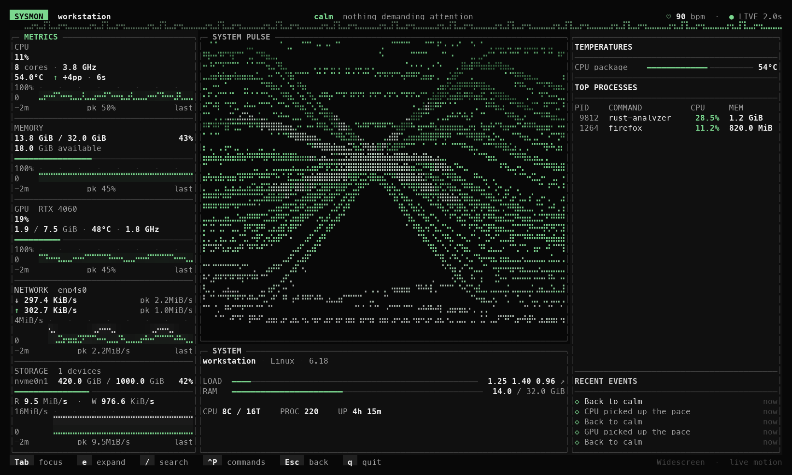

# Sysmon

Um monitor de sistema no terminal feito em Rust, com interface TUI leve, atualização em tempo real e visual de terminal para acompanhar CPU, RAM, GPU, discos, processos e rede.


## Preview



Captura do renderer real a 160×45, com dados sintéticos identificados do exemplo de desenvolvimento.

## Recursos

- Dashboard TUI usando `ratatui` e `crossterm`.
- Linha vital no cabeçalho: um traço de eletrocardiograma cujo ritmo (bpm), amplitude e onda T seguem o System Pulse, com diagnóstico em linguagem natural do que está ditando o ritmo.
- Tabela de processos sem threads duplicadas, com CPU por processo medida no próprio intervalo de coleta, colorida por calor e com medidor por linha.
- Mapa de núcleos no card de CPU: uma barra por núcleo lógico, revelando núcleos saturados mesmo quando a média está baixa.
- Instrumentos de telemetria em Braille, com timestamps reais, escalas, picos e preenchimento discreto.
- Narrador de eventos: mudanças de saúde que persistem (ex.: "CPU under sustained load", "Back to calm") entram em RECENT EVENTS com idade relativa.
- Painéis com foco branco e superfícies neutras no tema Pulse; verde para telemetria normal, amarelo para atenção e vermelho para estado crítico.
- CPU com escala fixa de 0–100%, comparação em pontos percentuais e detalhamento por núcleo no modo expandido.
- Informações de sistema: OS, kernel, uptime, cores, load average e quantidade de processos.
- Contexto operacional ao vivo com hostname, memória disponível, idade da amostra e identidade dos processos.
- RAM com barra de capacidade, memória disponível, histórico e contexto de swap quando disponível.
- Top 5 processos por uso de CPU, exibindo também PID e memória.
- Armazenamento com capacidade separada da atividade histórica de leitura/escrita.
- Rede com download/upload, picos recentes e escala compartilhada; interfaces adicionais aparecem nos detalhes.
- GPUs NVIDIA via `nvidia-smi`, quando disponível, exibindo todas as placas detectadas.
- Layout responsivo, com aviso quando o terminal não possui o tamanho mínimo necessário.
- Três temas, barras finas e cores consistentes; saída alternativa em ASCII, 16/256 cores ou monocromática.
- Primeira coleta real antes do desenho inicial, sem valores de demonstração na interface principal.
- Command palette, busca de processos, foco por widget e modo de movimento reduzido.
- Saída segura com restauração do terminal.

## Requisitos

- Rust instalado.
- Linux/macOS/Windows com terminal compatível.
- Opcional: `nvidia-smi` para mostrar dados de GPU NVIDIA.

## Instalação

Clone o repositório:

```bash
git clone https://github.com/gustavomfg/sysmon.git
cd sysmon
```

Execute em modo desenvolvimento:

```bash
cargo run
```

Esse é o único comando de execução e inicia o dashboard atual do SysMon.

Ou gere o binário otimizado:

```bash
cargo build --release
```

O executável ficará em:

```bash
target/release/sysmon
```

Para instalar localmente com Cargo:

```bash
cargo install --path .
```

Depois execute:

```bash
sysmon
```

## Atalhos

| Tecla | Ação |
| --- | --- |
| `q` | Sair |
| `Esc` | Fechar o painel atual ou sair |
| `Ctrl+C` | Sair |
| `Ctrl+P` | Abrir a command palette |
| `/` ou `Ctrl+F` | Buscar processos |
| `Tab` / `Shift+Tab` | Alternar o foco entre widgets |
| `j` / `k` ou `↑` / `↓` | Navegar entre widgets |
| `e` | Expandir/recolher o widget focado |

Na command palette, use as setas para navegar, `Enter` para executar e `Esc` para fechar. A opção `Settings` permite trocar o tema, reduzir o movimento e ajustar o intervalo de atualização.

## Como Funciona

O app coleta as métricas no intervalo configurado (1, 2 ou 4 segundos) e mantém a animação/renderização separada da coleta. Eventos de mouse não são capturados, evitando picos falsos de CPU ao mover ou rolar o mouse no terminal.

A coleta principal vem da crate `sysinfo`. Para GPUs, o app chama `nvidia-smi`, valida as métricas retornadas e exibe todas as placas com dados válidos quando o comando está disponível e retorna com sucesso. Uma linha inválida não impede a exibição das demais GPUs.

## Limitações

- GPUs são detectadas apenas em placas NVIDIA com `nvidia-smi` disponível.
- Rede e I/O aparecem em unidades binárias explícitas (`KiB/s`, `MiB/s`); startup e resets de rede produzem lacunas, sem taxas artificiais.
- O histórico retém 120 amostras por série. Os cards mostram os últimos dois minutos disponíveis; a expansão aproveita o histórico retido. Alterar a largura não muda a janela temporal.
- Históricos de GPU e armazenamento acompanham o dispositivo principal; os valores atuais dos demais dispositivos continuam disponíveis. Rede agrega interfaces que não são loopback, incluindo interfaces virtuais.
- Sensores sem limite crítico informado pelo driver usam uma escala visual neutra. As heurísticas gerais de saúde do SYSTEM PULSE continuam sendo as existentes.
- O layout ajusta a proporção dos painéis conforme a largura; abaixo do tamanho mínimo, o app exibe um aviso em vez de cortar o dashboard.

## Desenvolvimento

### Capturas dos gráficos

O exemplo abaixo usa dados **sintéticos identificados**, a aplicação real e o `TestBackend` do ratatui. Gera capturas textuais e por célula para cinco tamanhos, três temas e os principais modos expandidos:

```bash
cargo run --offline --release --example graphics_capture -- target/graphics-captures --bench
cargo run --offline --release --example graphics_capture -- target/graphics-animated --bench --animate
python3 tools/render_graphics_capture.py target/graphics-captures
python3 tools/smoke_graphics_terminal.py
python3 tools/benchmark_graphics_terminal.py target/release/sysmon --width 160 --height 45
```

A conversão opcional para PNG precisa de Pillow e uma das fontes indicadas no script. Não há dependência nova no executável. Veja a [comparação visual](docs/graphics/comparison.png), a [arquitetura](docs/graphics-architecture.md), a [pesquisa](docs/graphics-research.md) e os [resultados e medições](docs/graphics-overhaul-results.md).

O benchmark em PTY usa telemetria real durante oito segundos, descarta dois segundos de aquecimento e informa CPU relativa a um núcleo e RSS. Para comparar versões, alterne a ordem das execuções. Sua saída contém somente estatísticas, sem guardar informações da tela.

### Compatibilidade de terminal

Detecção padrão preserva Unicode e True Color em terminais modernos; `TERM=linux` ou `dumb` usa ASCII e 16 cores. Para configurar explicitamente:

```bash
SYSMON_COLOR=ansi256 cargo run --release
SYSMON_COLOR=mono SYSMON_GRAPHICS=ascii cargo run --release
```

`SYSMON_COLOR` aceita `truecolor`, `ansi16`, `ansi256` e `mono`; `SYSMON_GRAPHICS` aceita `unicode` e `ascii`. `NO_COLOR` desativa cores quando não há escolha explícita em `SYSMON_COLOR`.

Comandos úteis:

```bash
cargo fmt
cargo check
cargo clippy -- -D warnings
cargo test
```

Build limpo, se necessário:

```bash
cargo clean
cargo build --release
```

## Stack

- Rust 2024
- `ratatui`
- `crossterm`
- `sysinfo`

## Licença

Este projeto é disponibilizado sob a licença MIT.
