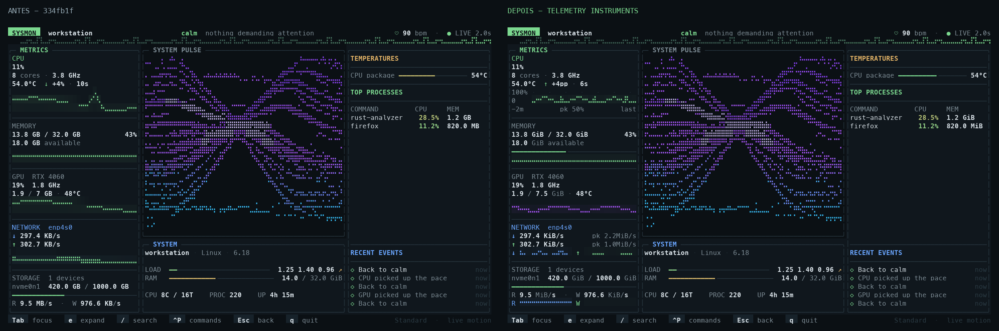

# Resultado da revisão gráfica

Concluído em 13/10/2026, a partir de `334fb1f`, na branch
`graphics/telemetry-instruments`. Sem push/publicação, dependências novas de
runtime ou alteração de licença. Exclusões preexistentes do usuário preservadas
e excluídas dos commits desta revisão.

## Entrega

- CPU: trace temporal de 0–100%, pico real, direção/delta em pp e intervalo da
  comparação; expansão com histórico retido e tabela de núcleos.
- RAM: capacidade proporcional, disponível e contexto de swap, mais histórico.
  Sem inventar cache ou PSI.
- GPU: atividade roxa, VRAM proporcional, temperatura/clock quando disponíveis;
  valores atuais de múltiplas GPUs preservados.
- Rede: download/upload, identidade da interface/agregação, picos e escala
  compartilhada com histerese; pistas separadas na expansão.
- Disco: capacidade separada de leitura/escrita, histórico bidirecional e
  inventário de dispositivos preservado.
- Temperaturas: régua discreta, leitura sem clamp a 100°C e referência crítica
  apenas quando reportada pelo driver.
- Históricos circulares, timestamps monotônicos, gaps reais, unidades binárias,
  cache de modelos/pixels e alternativas de saída do terminal.

O [fluxo e os contratos](graphics-architecture.md) e a
[pesquisa/auditoria](graphics-research.md) descrevem as decisões por componente.

## Evidência visual

As imagens são renderizações das **células reais do TestBackend com telemetria
sintética explícita**, não fotografias de hardware nem mockups de uma interface
que não existe. Fonte Meslo Mono, Pillow, células de 10×21 px.



- [Dashboard 160×45](graphics/dashboard.png)
- [CPU expandida](graphics/cpu-expanded.png)
- [Rede expandida](graphics/network-expanded.png)
- [Armazenamento expandido](graphics/storage-expanded.png)

Inspeção antes/depois: eixos e unidades legíveis, picos preservados, trilhos de
capacidade finos, menor preenchimento decorativo, cores consistentes e espaço
dedicado ao I/O. Capturados cinco tamanhos: 80×24, 100×30, 120×35, 160×45,
200×55; também três temas e cinco expansões. O perfil de 80×24 continua
priorizando Pulse, CPU e RAM, conforme o layout existente.

O painel completo de SYSTEM PULSE, incluindo símbolos, cores e modificadores,
foi **idêntico ao original nos cinco tamanhos**, no mesmo cenário determinístico:
[retângulos e hashes](graphics/pulse-comparison.json). Seu motor, campo, paleta,
rasterizador e relógio não foram alterados. Testes existentes de resposta às
métricas continuam passando. A captura estática não comprova ausência de
flicker em todos os emuladores.

## Validação executada

| Verificação | Resultado |
| --- | --- |
| Baseline: `cargo test --offline --all-targets` | 309 passaram, zero falhas |
| Final: mesmo comando | **331 passaram**, zero falhas/ignorados |
| `cargo fmt --check` | Passou |
| `cargo clippy --offline --all-targets -- -D warnings` | Passou |
| `cargo build --offline --release --bin sysmon --example graphics_capture` | Passou |
| `git diff --check` | Passou |
| Execução real em PTY, original/final em 80×24 e 160×45 | Quatro saídas 0, tela alternativa restaurada |
| Smoke com foco, expansão, busca, tema e resize | Passou em Unicode/True Color e ASCII/mono; modo raw restaurado |

Os testes adicionais cobrem wrap/expiração de buffer, ordem temporal após
expiração, bitmap além de 64 amostras, tempo irregular, startup esparso, picos
em larguras diferentes, escalas fixas/dinâmicas e histerese, NaN/infinito,
resets/wraps de rede, mudanças de dispositivo, unidades, clipping do traço e
preenchimento, canais compactos, referências térmicas e invalidação do cache.
Nenhum teste foi ignorado para obter aprovação; nenhum tamanho de stack foi
aumentado. Os novos testes verificam produção e geometria separadamente.

O primeiro harness PTY não respondeu à consulta de posição do cursor de
Crossterm e encerrou cedo; foi corrigido para emular essa resposta. O script
reproduzível está em `tools/smoke_graphics_terminal.py`, e
[seus resultados](graphics/terminal-smoke.jsonl) registram somente metadados,
sem salvar informações pessoais da captura de telemetria real.

## Desempenho medido

Host: AMD Ryzen 5 4600G, Linux; Rust 1.97.1; build release e mesmas dependências.
O original foi reconstruído em diretório próprio a partir de `git archive
334fb1f`, sem trocar a árvore de trabalho. Fixture equivalente nas duas versões;
apenas os campos opcionais novos são omitidos na fixture original.

### Quadro com tempo congelado

Cinco rodadas alternando original/final; 10 frames de aquecimento e 100 medidos
por caso. Medianas, em microssegundos/frame. Inclui desenho completo em
TestBackend, com caches aquecidos; não inclui coleta nem geração de nova fase
do Pulse.

| Terminal | Original | Final | Variação |
| --- | ---: | ---: | ---: |
| 80×24 | 118,56 | 77,87 | −34,3% |
| 100×30 | 169,60 | 121,25 | −28,5% |
| 120×35 | 223,76 | 162,86 | −27,2% |
| 160×45 | 334,53 | 257,70 | −23,0% |
| 200×55 | 472,05 | 377,47 | −20,0% |

Expansões: CPU +11,2%, RAM +9,6%, GPU −13,7%, rede −59,5%, armazenamento −6,6%.
CPU/RAM acrescentam aproximadamente 23–27 µs por frame neste cenário; a cópia
do buffer expandido tem custo proporcional à área. Não é alegado ganho em
todos os modos. [Todas as medianas](graphics/render-benchmark.csv) e
[rodadas brutas](graphics/render-benchmark-raw.csv).

### Animação avançando 50 ms/frame

Três rodadas equivalentes com `--bench --animate`. Em 160×45: 12.398 → 12.092
µs/frame (−2,5%); 200×55: 16.445 → 16.238 µs/frame (−1,3%). Nos três temas em
120×35 as diferenças são pequenas, incluindo +0,4% em um tema. Ganhos grandes
do quadro congelado **não representam o ganho total com animação ativa**.
[Medianas](graphics/animated-benchmark.csv),
[dados brutos](graphics/animated-benchmark-raw.csv).

### Aplicação real, oito segundos por execução

Coleta real, PTY drenado, amostragem de `/proc` do próprio processo depois de
dois segundos de aquecimento; janela medida de aproximadamente 5,8 s. CPU é
percentual de **um núcleo**, não percentual de toda a máquina. Uma execução
por combinação, portanto sem conclusão estatística de ganho geral.

| Terminal | CPU original → final | RSS máximo original → final |
| --- | ---: | ---: |
| 80×24 | 49,75% → 46,78% | 6.824 → 7.404 KiB |
| 160×45 | 28,36% → 27,81% | 7.980 → 8.812 KiB |

[Amostragens resumidas](graphics/live-benchmark.json). O consumo total com
animação **continua alto** nesta máquina. O contraste com o quadro congelado e
os modos expandidos sugere que gerar novas fases do Pulse domina o custo; isso
é uma inferência dos benchmarks e do caminho de código, não um perfil de
funções instrumentado. A revisão lateral não resolve esse limite preexistente.
O aumento observado de RSS é compatível com mais histórico e cache de pixels;
não foi executado teste de vazamento durante dias.

## Reproduzir

```bash
cargo test --offline --all-targets
cargo clippy --offline --all-targets -- -D warnings
cargo build --offline --release --bin sysmon --example graphics_capture
target/release/examples/graphics_capture target/graphics-captures --bench
target/release/examples/graphics_capture target/graphics-animated --bench --animate
python3 tools/render_graphics_capture.py target/graphics-captures
python3 tools/smoke_graphics_terminal.py
```

## Limitações e próximos aprimoramentos

- GPU real NVIDIA/múltiplas placas não validada neste host AMD; fixtures e
  testes validam disponibilidade e inventário. Suporte de drivers não ampliado.
- Séries históricas acompanham GPU/disco principais; seleção e históricos
  independentes por dispositivo seriam uma melhoria futura.
- Swap permanece contextual; não há coleta de PSI nem cache detalhado.
- Sobreposição de duas séries em altura intermediária ainda compartilha a
  única cor de frente da célula; expansão oferece pistas separadas.
- Autozoom percentual foi removido em favor de leitura absoluta; oscilações
  pequenas exigem expansão para ganhar resolução vertical.
- Fallback testado por células e PTY; diversidade de fontes, emuladores,
  sessões SSH lentas e execução prolongada não foi validada.
- Próxima prioridade de desempenho: perfilar o caminho animado do Pulse e
  suas alocações, preservando sua identidade, métricas e resultado visual.
  Otimização desse motor não foi incluída nesta revisão lateral.
